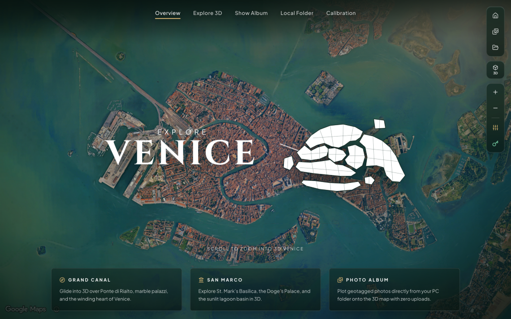
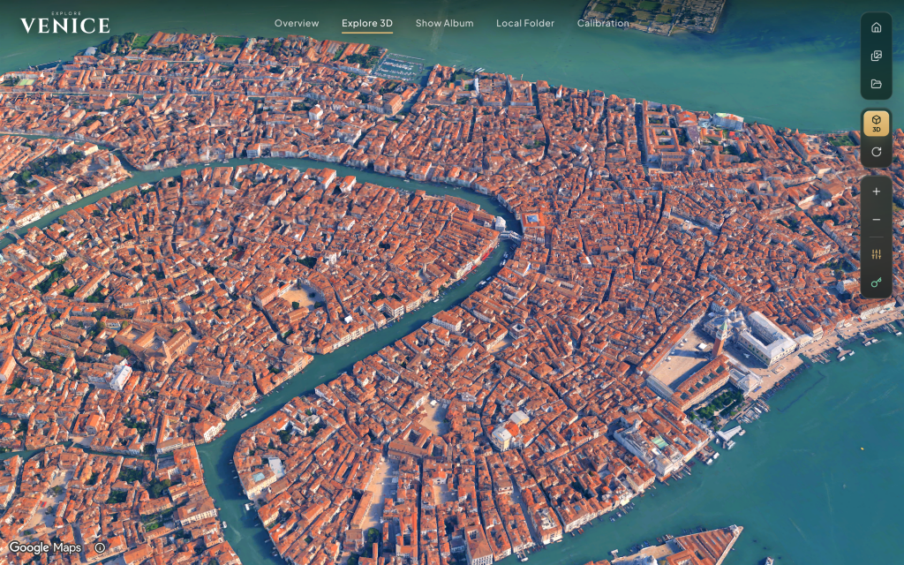
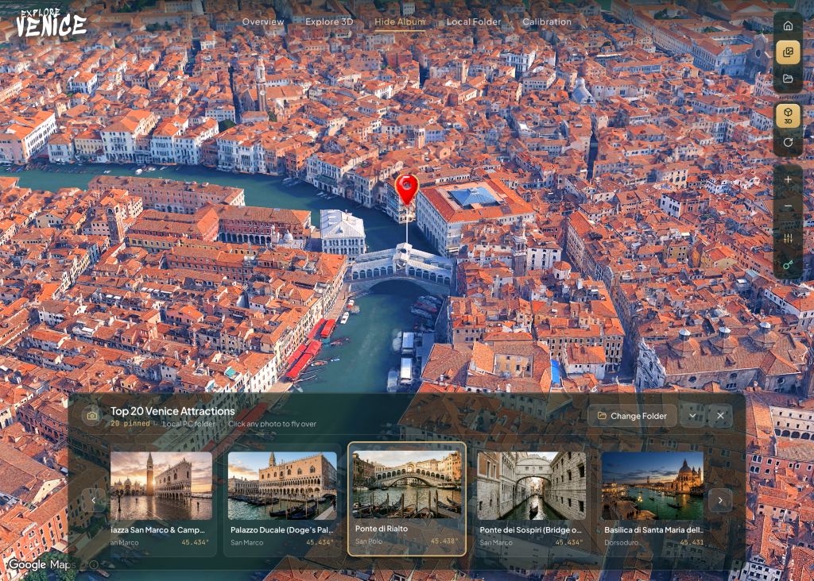
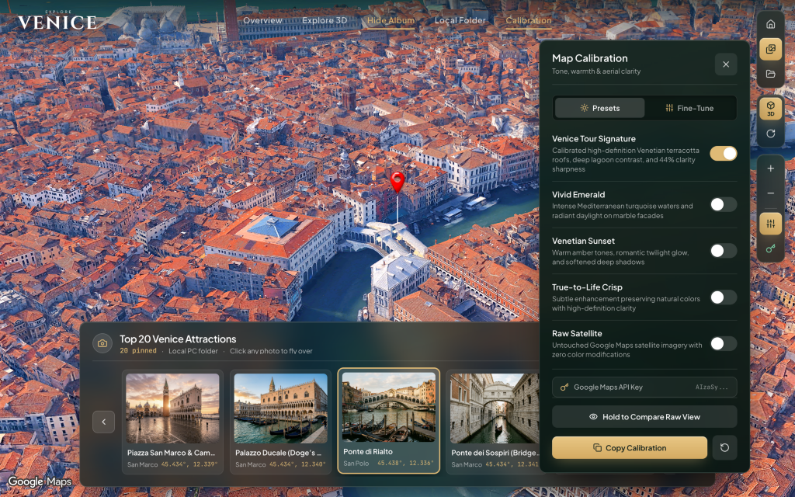
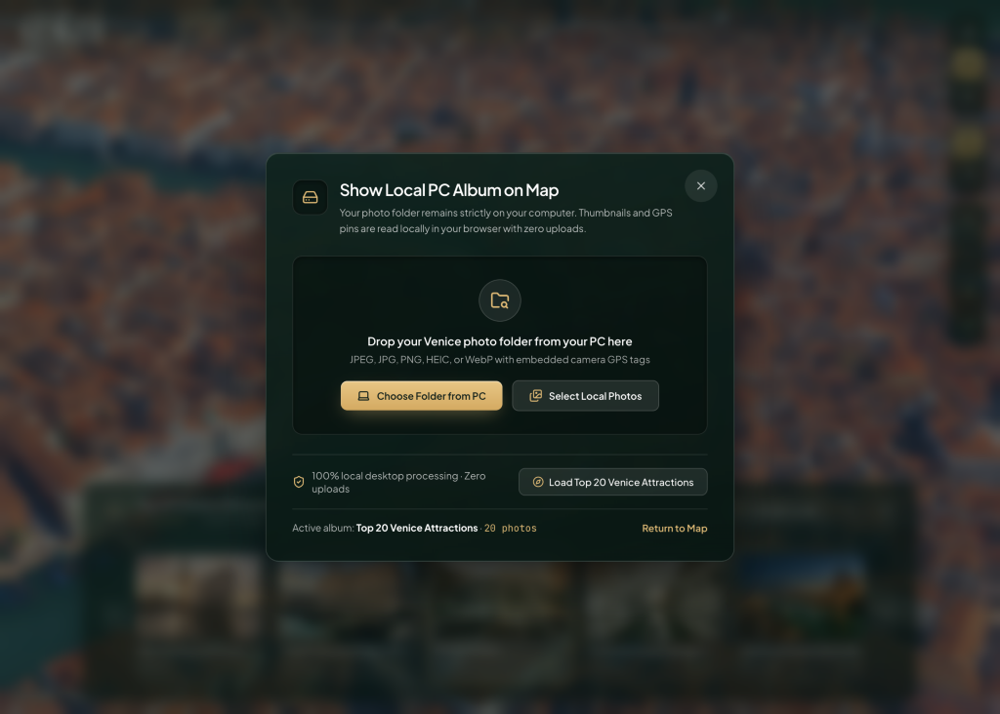
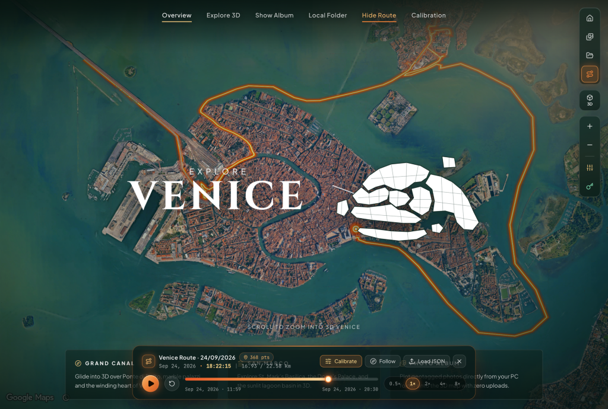
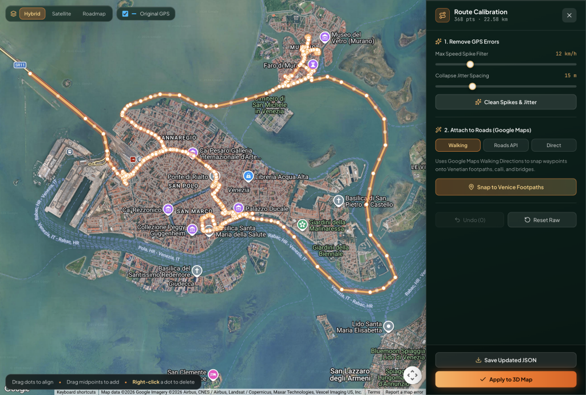
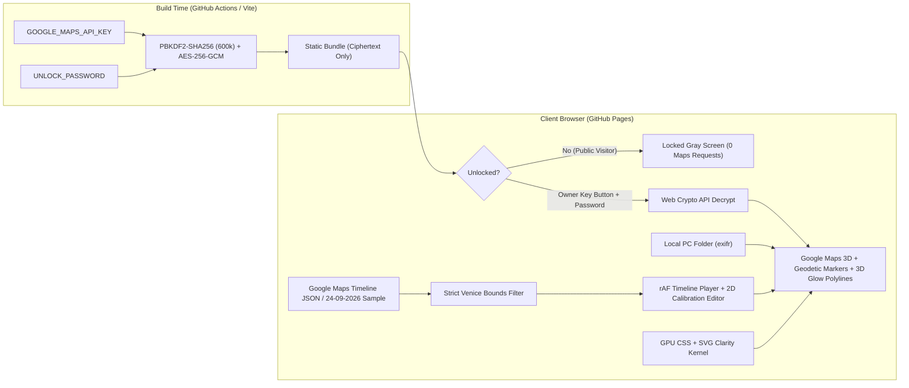

# VeniceMap — Interactive 3D Aerial Tour & Geotagged Photography

> A high-definition, photorealistic 3D aerial exploration of Venice built on Google Maps 3D Tiles, paired with glowing 3D GPS route timeline playback, a 2D Satellite route calibration editor, live GPU color calibration, cinematic camera orbits, zero-upload local EXIF GPS photo plotting, and a password-protected AES-256-GCM API key vault.

[](https://talmalek.github.io/VeniceMap/)


---



---

## ✨ Key Features

### 1. Photorealistic 3D Venice Globe & Cinematic Camera
- Powered by **Google Maps Photorealistic 3D Tiles** (`<gmp-map-3d>` via `@vis.gl/react-google-maps`) with bounded Venice lagoon guard rails.
- Smooth `flyCameraTo` transitions between top-down overview, 60° 3D tilted perspective, 45° heading rotation, and continuous landmark orbits.
- Automatic orbit pause when the browser tab moves to the background (Page Visibility API) to save GPU and battery.
- Dynamic brush-script hero header and vector cartographic silhouette of Venice's six historic *Sestieri* that glide away smoothly as you zoom in.



---

### 2. Geotagged Photo Album & 3D Geodetic Markers
- Includes a curated **Top 20 Venice Attractions** album (Piazza San Marco, Ponte di Rialto, Palazzo Ducale, Ponte dei Sospiri, Basilica di Santa Maria della Salute, Murano, and more).
- Plots custom **Glossy 3D Red Pins** (`Marker3D` with `AltitudeMode.RELATIVE_TO_MESH`) anchored directly onto the 3D Venetian building mesh.
- Clicking any photo card in the bottom filmstrip smoothly flies the 3D camera to the exact GPS coordinates and begins a slow aerial orbit around the landmark.



---

### 3. Live GPU Color Grading & Clarity Calibration
- Real-time GPU-accelerated CSS filter pipeline combined with an **SVG 3×3 high-pass convolution kernel** (`feConvolveMatrix`) for architectural clarity and terracotta roof sharpness.
- Five curated presets (**Venice Tour Signature**, **Vivid Emerald**, **Venetian Sunset**, **True-to-Life Crisp**, and **Raw Satellite**) plus fine-tune sliders for Brightness, Contrast, Saturation, Clarity, Warmth, Vibrance, Highlights, and Shadows.
- **Hold to Compare Raw View** button to instantaneously A/B compare calibrated imagery against untouched satellite tiles.
- Settings persist locally in `localStorage` with one-click JSON export.



---

### 4. Zero-Upload Local Folder EXIF GPS Importer
- Drop or select any local photo folder (`JPEG`, `JPG`, `PNG`, `HEIC`, `WebP`) directly from your computer.
- Extracts embedded camera EXIF GPS coordinates entirely client-side using `exifr` with **zero server uploads** — your personal travel photos never leave your device.
- Non-blocking batch parsing using `scheduler.yield()` keeps UI input responsive during large folder imports, with automatic `URL.revokeObjectURL()` memory cleanup.



---

### 5. Glowing 3D Route Timeline Playback & Built-In 24/09/2026 Walk
- Click **Show Route** (top navigation bar or right utility dock) to immediately play the embedded, calibrated **Venice Route · 24/09/2026** example (`368` vertices, `22.58 km`), or click **Load JSON** to import your own Google Maps Timeline export (`routePoints`, `semanticSegments`, or Takeout `locations`).
- **Strict Map-Bounds Filtering**: During import, coordinates outside Venice map guard rails are discarded immediately so out-of-bounds data never enters memory.
- Semi-transparent Venetian frosted glass timeline bar with Play/Pause, Restart, manual timeline scrubbing, variable speeds (`0.5×`, `1×`, `2×`, `4×`, `8×`), live timestamp/distance readout, and an optional **Follow** camera toggle.
- Progressive 60fps molten-amber glowing 3D route rendered via 3 synchronized `Polyline3DElement` layers plus a pulsing 3D head beacon.



---

### 6. 2D Satellite Route Calibration Editor & Google Maps Footpath Snapping
- Click **Calibrate** from the timeline bar (or inside **Calibration** settings) to open a full-screen 2D Google **Hybrid / Satellite / Roadmap** editor.
- **Automated GPS Cleaning**: Remove speed-spike teleports, boomerang multipath errors, and stationary jitter clusters with live threshold sliders.
- **Google Maps Road & Footpath Snapping**: Attach drifted GPS points to real Venetian footpaths, *calli*, and bridges via Google Maps **Walking Directions** (with automatic direct-line fallback for water/vaporetto crossings), plus selectable **Roads API** and **Direct** modes.
- **Manual Vertex Editing & Export**: Drag vertices onto exact streets, drag midpoints to add points, right-click any vertex to delete errors, toggle the blue **Original GPS** reference overlay, Undo/Reset, **Apply to 3D Map**, and **Save Updated JSON** (`*_calibrated.json`).



#### Example Route JSON Format
Upload a `.json` file using the recommended `routePoints` structure (coordinates outside Venice bounds `45.4112–45.4607°N`, `12.2793–12.3921°E` are filtered out automatically on import):

```json
{
  "date": "2026-09-24",
  "location": "Venice, Italy",
  "routePoints": [
    {
      "timestamp": "2026-09-24T08:59:00.000Z",
      "lat": 45.4525606,
      "lng": 12.3006848
    },
    {
      "timestamp": "2026-09-24T09:25:10.000Z",
      "lat": 45.4380124,
      "lng": 12.3358912
    },
    {
      "timestamp": "2026-09-24T17:30:00.000Z",
      "lat": 45.4341667,
      "lng": 12.3387778
    }
  ]
}
```

> Also supports raw Google Maps Timeline exports (`semanticSegments[].timelinePath`) and legacy Google Takeout (`locations[]` with `latitudeE7` / `longitudeE7`).

---

### 7. Password-Protected Client-Side API Key Vault
- Built specifically for static hosting (GitHub Pages) where you want to showcase a Google Maps 3D project without exposing your API key or quota to public visitors.
- At build time, Vite encrypts the Google Maps API key using **PBKDF2-SHA256 (600,000 iterations)** and **AES-256-GCM** with a random salt and IV, stripping the raw key from the bundle.
- Public visitors see a neutral locked gray screen with **zero Google Maps API calls**.
- Clicking the top-right **Key** button opens the Owner Unlock modal, which decrypts the key in-browser using the native **Web Crypto API** (`window.crypto.subtle`) and mounts the 3D map immediately.

---

## 🏗️ Architecture & Security Flow



### Architecture Documentation & Knowledge Graph
- **Software Design Record (SDR)**: [docs/SDR.md](docs/SDR.md) — Architecture decisions (`SDR-001` through `SDR-006`) and module inventory.
- **Codebase Knowledge Graph (Graphify)**: [graphify-out/GRAPH_REPORT.md](graphify-out/GRAPH_REPORT.md) · [Interactive Graph HTML](graphify-out/graph.html) · [graph.json](graphify-out/graph.json).

---

## 🛠️ Tech Stack

| Layer | Technology | Purpose |
| :--- | :--- | :--- |
| **Framework** | React 19 + TypeScript | Component architecture with lazy-loaded drawers/modals |
| **3D Mapping & Routes** | `@vis.gl/react-google-maps` (`maps3d`, `routes`) | Photorealistic 3D tiles, geodetic `Marker3D`, 3-layer glowing `Polyline3DElement`, 2D editable calibration & Walking Directions snap |
| **Styling** | Tailwind CSS v4 + Lucide Icons | Glassmorphic lagoon-emerald UI & editorial typography |
| **EXIF Parsing** | `exifr` | 100% client-side GPS metadata extraction from local photos |
| **Cryptography** | Node `crypto` + Browser Web Crypto API | Build-time AES-256-GCM encryption & runtime decryption |
| **Build & Deploy** | Vite 8 + GitHub Actions | Optimized manual chunking and automated GitHub Pages CI/CD |

---

## 🚀 Local Development

### Prerequisites
- Node.js `>= 20`
- A Google Cloud project with **Maps JavaScript API** and **Map Tiles API** enabled

### Setup
```bash
git clone https://github.com/talmalek/VeniceMap.git
cd VeniceMap
npm install
```

Create a local `.env` file (gitignored):
```env
GOOGLE_MAPS_API_KEY="YOUR_GOOGLE_MAPS_API_KEY"
UNLOCK_PASSWORD="YOUR_STRONG_PASSWORD"
```

> [!IMPORTANT]
> **API Key HTTP Referrer Restrictions**:
> The project Google Maps API key is restricted by HTTP Referrer to:
> - `http://127.0.0.1:4174/VeniceMap/*` (Local debugging)
> - `https://talmalek.github.io/VeniceMap/*` (Production GitHub Pages)
>
> You must run and access the local application at:
> **`http://127.0.0.1:4174/VeniceMap/`**
> Running on `localhost`, another port, or without `/VeniceMap/` will trigger a Google Maps referrer restriction error (`gm_authFailure`).

Run the development server:
```bash
npm run dev
# Vite runs at http://127.0.0.1:4174/VeniceMap/
```

Or build and preview the production bundle (with the encrypted vault active):
```bash
npm run build
npm run preview
# Serves at http://127.0.0.1:4174/VeniceMap/
```

---

## 🌐 Deploying Your Own Copy on GitHub Pages

1. Fork or clone this repository and enable **GitHub Pages** (**Settings → Pages → Source: GitHub Actions**).
2. Add two repository secrets in **Settings → Secrets and variables → Actions**:
   - `GOOGLE_MAPS_API_KEY` — Your Google Maps Platform API key
   - `UNLOCK_PASSWORD` — Your personal unlock password
3. In Google Cloud Console, restrict your API key by **HTTP Referrer** (`https://<your-username>.github.io/VeniceMap/*`) and restrict APIs to **Maps JavaScript API** and **Map Tiles API**.
4. Push to `main` (or trigger **Actions → Deploy to GitHub Pages**).

---

## 📄 License

Licensed under the Apache-2.0 License.
