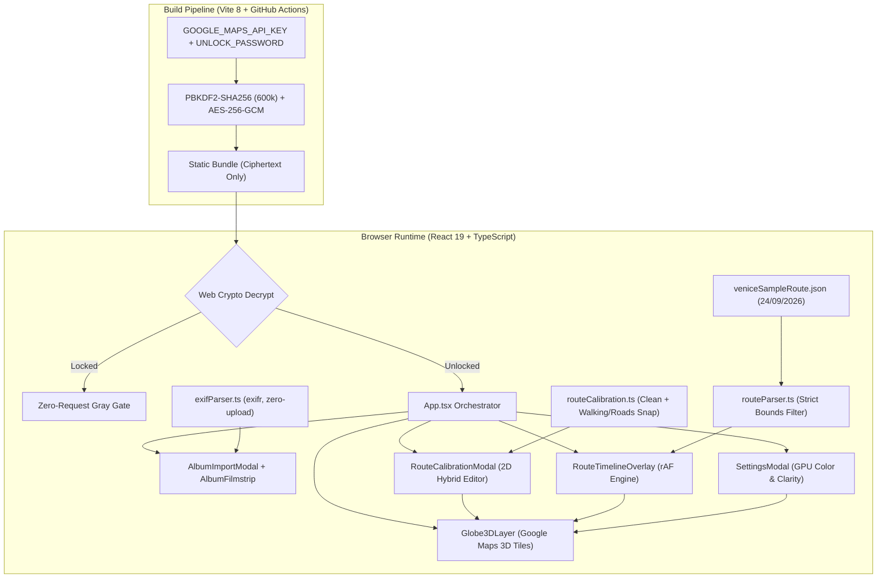

# VeniceMap — Software Design Record (SDR)

> **Project**: VeniceMap (Interactive 3D Aerial Tour, Geotagged Photography & Route Playback)
> **Updated**: 2026-11-26
> **Status**: Active / Production (GitHub Pages)

---

## 1. System Architecture

---

## 2. Core Engineering Decisions

### SDR-001: Client-Side AES-256-GCM API Key Vault
- **Context**: Static GitHub Pages hosting exposes client bundles publicly; raw Google Maps 3D Tile keys risk unauthorized quota consumption.
- **Decision**: Encrypt `GOOGLE_MAPS_API_KEY` at Vite build time using PBKDF2-SHA256 (600,000 iterations) + AES-256-GCM (`src/utils/cryptoKey.ts`). Public visitors see a zero-request locked screen until the owner decrypts the key in-browser via `window.crypto.subtle`.
- **Constraint**: Google Cloud API key enforces HTTP Referrer restrictions (`http://127.0.0.1:4174/VeniceMap/*` and `https://talmalek.github.io/VeniceMap/*`).

### SDR-002: Strict In-Memory Map-Bounds Filtering for Route Imports
- **Context**: Google Maps Timeline exports often include airport transfers and mainland transit (e.g., Marco Polo Airport, Mestre) outside historic Venice.
- **Decision**: `parseRouteJson()` and `parseRouteObject()` in `src/utils/routeParser.ts` filter every coordinate against `VENICE_HOME_GUARD_RAILS` (`45.4112–45.4607°N`, `12.2793–12.3921°E`) during ingestion. Out-of-bounds points are immediately discarded and never retained in React state or memory.
- **Consequence**: Timeline start/end boundaries, distance calculations, and scrubbing always reflect only the Venice exploration window.

### SDR-003: Multi-Layer Molten-Amber 3D Route Glow
- **Context**: Google Maps 3D (`Polyline3DElement`) does not natively apply CSS blur filters to 3D strokes.
- **Decision**: Stack three synchronized `google.maps.maps3d.Polyline3DElement` layers (`CLAMP_TO_GROUND`, `drawsOccludedSegments: true`) directly inside `Map3DElement`:
  1. Wide outer crimson-orange bloom (`24px`, `rgba(255, 58, 0, 0.24)`)
  2. Mid fiery orange glow (`12px`, `rgba(255, 122, 24, 0.62)`)
  3. Hot molten-amber core (`4.5px`, `#FFF3C4` with `#FF8C2A` outer edge)
  Paired with a pulsing SVG radial-gradient `Marker3D` head beacon and linear interpolation between GPS samples at 60fps via `requestAnimationFrame`.

### SDR-004: 2D Hybrid Satellite Route Calibration Editor
- **Context**: `Map3DElement` (`maps3d`) lacks native drag-to-edit polyline vertex handles, and Venetian narrow alleys (*calli*) cause GPS multipath drift. Furthermore, Google Roads API only snaps to vehicle roads, which do not exist in historic Venice.
- **Decision**: Provide a code-split full-screen 2D Google Satellite/Hybrid editor (`RouteCalibrationModal.tsx`) using native `google.maps.Polyline` (`editable: true`):
  - **Manual Editing**: Drag vertices, drag midpoints to insert, right-click vertices to delete, with a 20-step Undo stack and Original GPS reference overlay.
  - **Automated GPS Cleaning**: Speed-spike and boomerang-multipath filter + stationary jitter spacing collapse (`cleanGpsErrors`).
  - **Google Maps Snapping**: Default **Walking Directions** (`DirectionsService`, `WALKING` mode) batched in 24-point chunks to snap onto Venetian footpaths and bridges, with automatic direct-line fallback on water/vaporetto crossings. Optional **Roads API** (`snapToRoads`) and **Direct** modes selectable.
  - **Persistence**: Apply live to the 3D globe and export calibrated JSON (`*_calibrated.json`).

### SDR-005: On-Demand Code-Split Embedded Sample Route
- **Context**: Visitors should be able to experience route playback immediately without uploading a file, matching the built-in Top 20 Venice Attractions album.
- **Decision**: Embed the calibrated `24/09/2026` Venice walk (`368` vertices, `22.58 km`) at `src/data/veniceSampleRoute.json` and load it via dynamic `import()` (`5.68 kB` gzipped chunk) only when **Show Route** is clicked. Users can switch between the embedded example and their own custom Google Maps JSON files at any time.

### SDR-006: Zero-Upload Local EXIF Photo Plotting & GPU Color Grading
- **Context**: Personal travel photos must remain private while rendering crisp 3D pins and calibrated aerial imagery.
- **Decision**: Parse local photo folders client-side via `exifr` with `scheduler.yield()` batching and `URL.revokeObjectURL()` cleanup. Apply live color grading via GPU CSS filters plus an SVG 3×3 `feConvolveMatrix` high-pass clarity filter.

---

## 3. Module Inventory

| Module | Responsibility |
|---|---|
| `src/App.tsx` | Root state, API key vault gate, navigation, playback loop, modal orchestration |
| `src/components/Globe3DLayer.tsx` | 3D Google Maps container, camera flights/orbits, `Marker3D` pins, 3-layer glowing `Polyline3DElement` |
| `src/components/RouteTimelineOverlay.tsx` | Semi-transparent frosted glass timeline bar, speed controls (`0.5×`–`8×`), scrubber, follow-camera toggle |
| `src/components/RouteCalibrationModal.tsx` | 2D Hybrid/Satellite polyline editor, GPS error cleaner, Walking/Roads snapping, JSON export |
| `src/utils/routeParser.ts` | Multi-format Google Maps JSON parser, strict Venice bounds filter, binary-search linear interpolator |
| `src/utils/routeCalibration.ts` | Haversine metrics, spike/jitter filter, batched `DirectionsService` & Roads API snappers, JSON downloader |
| `src/data/veniceSampleRoute.json` | Calibrated `24/09/2026` Venice walking route example (lazy-loaded) |
| `src/components/SettingsModal.tsx` | GPU color grading presets, fine-tune sliders, raw comparison, route calibration launcher |
| `src/components/AlbumFilmstrip.tsx` & `AlbumImportModal.tsx` | Geotagged photo filmstrip and zero-upload local folder EXIF importer |
| `src/utils/cryptoKey.ts` | Runtime Web Crypto PBKDF2 + AES-256-GCM decryption |
